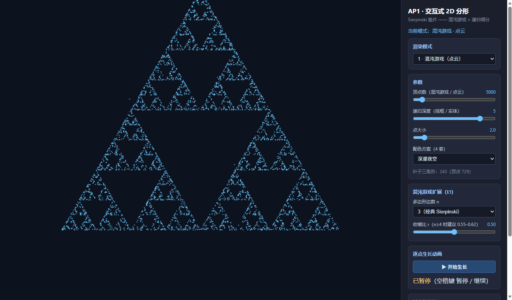
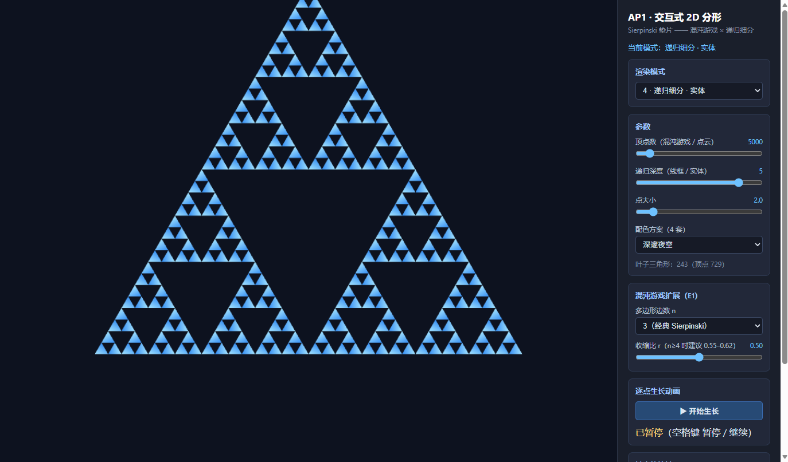
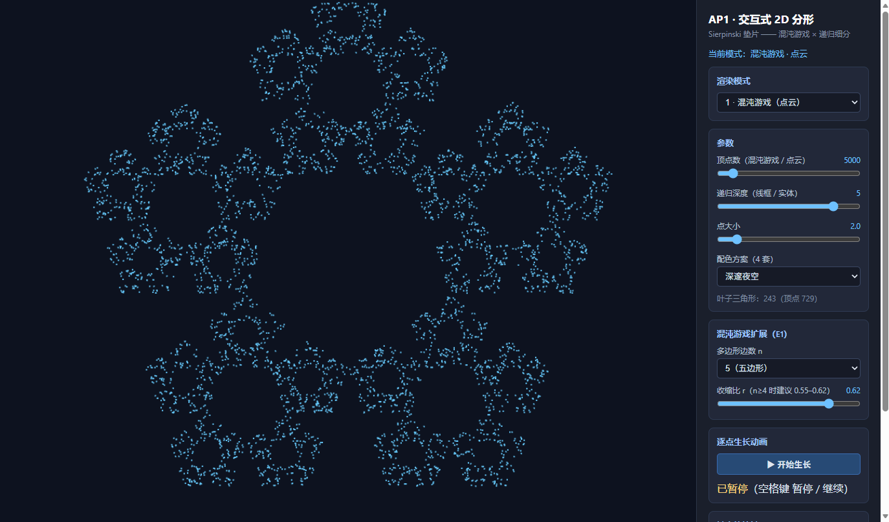
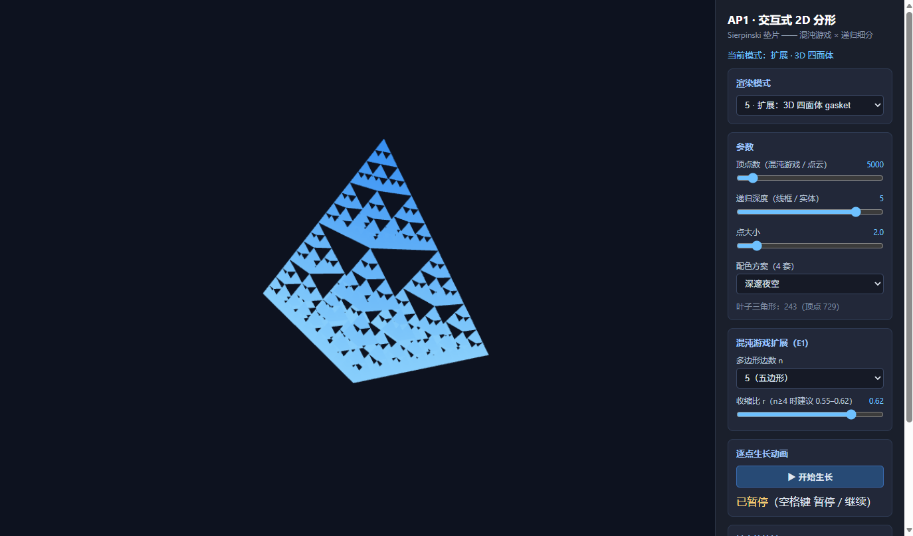

# AP1 · 交互式 2D 分形 —— Sierpinski 垫片

计算机图形学课程 Assigned Project 1。原生 **WebGL 2.0 + JavaScript**，使用教材
（Angel & Shreiner, *Interactive Computer Graphics*, 8th ed.）配套工具库风格，
无构建步骤，任意静态服务器即可运行。

- **可运行 URL**：https://huangshuoxian.github.io/computer-graphics/AP1/ （GitHub Pages）
- **源码**：见随附 `AP1.zip`（或本仓库 `AP1/` 目录）

---

## 1. 运行方式

```bash
# 在本目录（AP1/）下任选一种静态服务器：
python -m http.server 8000
# 或
npx serve .
```

浏览器打开 `http://localhost:8000/index.html`（支持 WebGL 2.0 的现代浏览器即可）。

## 2. 实现要点

### 2.1 混沌游戏（Chaos Game）生成 Sierpinski 垫片

教材 Ch2 的随机迭代算法：

1. 在三角形内取一个随机初始点 `p`；
2. 每轮随机选取三角形的一个顶点 `v`，令 `p ← (p + v) / 2`（即收缩比 r = 0.5）；
3. 反复迭代（默认 5000 次，面板可调至 50000），把每次得到的 `p` 存入
   `Float32Array`，以 `gl.POINTS` 渲染。

数学上，该随机迭代过程的吸引子（attractor）恰好是 Sierpinski 垫片——
无论初始点在哪，点云都会收敛到垫片上。

### 2.2 递归细分（Recursive Subdivision）生成垫片

实现教材 Ch2 的 `subdivide(triangle, depth)`：

- 对三角形三边取中点，连成 4 个小三角形，**丢弃中间倒置的那个**；
- 对三个角上的小三角形递归调用，深度 `depth` 可由用户输入（0–6，深度 6 时
  叶子三角形 3⁶ = 729 个，不崩溃）；
- 同一组叶子三角形支持三种渲染模式切换：
  - **点云**：每个叶子三角形的 3 个顶点 → `gl.POINTS`；
  - **线框**：每个叶子三角形 3 条边 × 2 端点 → `gl.LINES`；
  - **实体**：叶子三角形顶点本身 → `gl.TRIANGLES`（片元按高度做双色渐变）。

### 2.3 数据流

```
geometry.js（算法，纯 JS 计算）
    → Float32Array（顶点数据）
    → renderer.js：gl.bufferData → VBO
    → gl.vertexAttribPointer 绑定 attribute
    → gl.drawArrays（POINTS / LINES / TRIANGLES）
```

### 2.4 视图变换

平移 / 缩放不依赖 `gl.viewport` 技巧，而是为每个顶点乘一个 `mat4` 视图矩阵
（用 `MV.js` 的 `translate` / `scalem` / `mult` 手工组合）：

```
u_view = T(tx, ty) · S(scale, scale·aspect)
```

先缩放（y 轴乘画布宽高比保证等比），再平移；滚轮缩放时按"光标下的世界点不动"
反解平移量。这套组合对应教材 Ch3 的二维变换内容。

## 3. 交互说明

| 操作 | 效果 |
|---|---|
| 鼠标左键拖动 | 平移视图 |
| 滚轮 | 以光标为中心缩放 |
| `1` / `2` / `3` | 切换渲染模式（混沌游戏 / 点云 / 线框） |
| `4` / `5` | 实体模式 / 3D 四面体预览（扩展） |
| `空格` | 暂停 / 继续"逐点生长"动画（点数从 0 随时间增长到设定值，长满了再按空格会重新生长） |
| `R` | 复位视图 |
| `← → ↑ ↓` | 3D 模式下旋转 |

参数面板（HTML 控件）：渲染模式切换、顶点数（1000–50000）、递归深度（0–6）、
点大小（1–10）、**4 套配色方案**、混沌游戏边数 n 与收缩比 r（扩展 E1）、
生长动画按钮。

## 4. 三种渲染模式截图

**混沌游戏 · 点云（模式 1，5000 点）：**



**递归细分 · 线框（模式 3，深度 5）：**


**递归细分 · 实体（模式 4，深度 5）：**



## 5. 选做扩展

### E1：任意 n 边形混沌游戏

混沌游戏算法天然推广到任意正 n 边形。切换边数 n（4/5/6/8）可观察差异：

- n = 3、r = 0.5 即经典 Sierpinski 垫片；
- n ≥ 4 时 r = 0.5 的点云趋于弥散，**r ≈ 0.55–0.62 才出现清晰的 n 重分形结构**
  （面板切换边数时会自动给出推荐收缩比，也可手动拖动滑条观察 r 的影响）。

n = 5、r = 0.62 的五边形分形：



### E3：3D 四面体 gasket 预览（为 AP2 铺垫）

把混沌游戏的"中点迭代"思想搬到三维：对四面体六条棱取中点、剖成 4 个小四面体
并丢弃中央八面体区域（等价于保留四角），递归细分后用 `gl.TRIANGLES` 绘制，
MVP 矩阵由 `MV.js` 的 `perspective` / `rotateX` / `rotateY` / `translate` / `mult`
手工组合，开启深度测试，自动缓慢旋转，方向键可交互旋转：



## 6. 代码结构

```
AP1/
├── index.html            页面与参数面板（HTML 控件）
├── Common/               教材配套工具库（本项目内按 8th ed. API 重写）
│   ├── initShaders.js    着色器编译 / 链接
│   ├── MV.js             vec/mat4 与基本变换（列主序）
│   └── webgl-utils.js    WebGL 2.0 上下文获取
├── js/
│   ├── geometry.js       几何生成：混沌游戏 / 递归细分 / 四面体 gasket（纯计算）
│   ├── renderer.js       渲染器：着色器、VBO、三种渲染模式、视图矩阵
│   ├── interaction.js    鼠标（拖动平移 / 滚轮缩放）与键盘交互
│   ├── ui.js             参数面板控件绑定
│   └── main.js           入口：装配模块 + 渲染循环（生长动画驱动）
└── screenshots/          README 截图
```

几何 / 渲染 / 交互 / UI 分文件，模块间仅通过 `Renderer.state` 与公开接口通信，
无全局变量滥用。

## 7. 备注

- 除教材工具库 API 外所有代码独立撰写；
- 配色、顶点数等默认值均可在 `renderer.js` 的 `state` 中调整。
